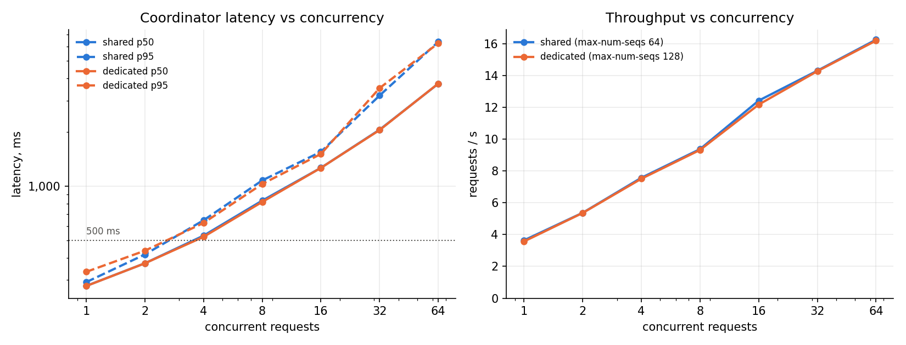

# D. Max-capacity ramp: vLLM coordinator (Nemotron 3.5 Lightning NVFP4)

Same requests as A (coordinator prompt, tools and validator; temperature 0, thinking off, max_tokens 200, streamed). Levels 1 2 4 (below the ramp, for the SLO point) then 8 16 32 64 128, up to 2 x max-num-seqs; 3 warm-up + max(20, 2 x level). A watchdog sampled the GPU every 2 s (`gpu_trace.csv`).

Kernels: Marlin weight-only FP4 + Triton attention (no native FP4/FlashInfer); numbers are conservative.

## SHARED (`nvidia/NVIDIA-Nemotron-3.5-Lightning-30B-A3B-NVFP4 --host 127.0.0.1 --port 8001 --max-model-len 16384 --gpu-memory-utilization 0.55 --attention-backend TRITON_ATTN --enable-auto-tool-choice --tool-call-parser qwen3_coder --reasoning-parser nemotron_v3 --enable-prefix-caching --max-num-seqs 64`)

| Conc. | n | latency p50 / p95 / p99 ms | TTFT p50 / p95 / p99 ms | req/s | out tok/s | valid (expected) | regressions | errors | peak GiB / °C / W |
|---:|---:|---:|---:|---:|---:|---:|---:|---:|---:|
| 1 | 20 | 278.5 / 292.3 / 333.6 | 90.2 / 92.5 / 92.8 | 3.64 | 250.9 | 85% (85%) | 0 | 0.0% | 61.6 / 51.0 / 305.15 |
| 2 | 20 | 372.3 / 416.9 / 441.2 | 97.3 / 147.2 / 150.3 | 5.37 | 366.3 | 85% (85%) | 0 | 0.0% | 62.0 / 53.0 / 376.07 |
| 4 | 20 | 530.7 / 646.3 / 647.4 | 190.1 / 240.3 / 240.7 | 7.57 | 518.8 | 85% (85%) | 0 | 0.0% | 62.5 / 58.0 / 376.07 |
| 8 | 20 | 831.8 / 1077.9 / 1087.5 | 356.5 / 437.8 / 438.1 | 9.37 | 634.5 | 85% (85%) | 0 | 0.0% | 62.5 / 58.0 / 397.71 |
| 16 | 32 | 1266.3 / 1555.6 / 1557.1 | 805.3 / 822.6 / 829.4 | 12.42 | 815.6 | 91% (91%) | 0 | 0.0% | 62.7 / 61.0 / 433.49 |
| 32 | 64 | 2065.2 / 3202.0 / 3619.2 | 1524.0 / 1586.7 / 1592.1 | 14.3 | 936.9 | 92% (92%) | 0 | 0.0% | 62.7 / 61.0 / 447.6 |
| 64 | 128 | 3724.6 / 6376.6 / 6692.4 | 1762.9 / 3115.6 / 3143.0 | 16.25 | 1065.4 | 92% (92%) | 0 | 0.0% | 63.0 / 64.0 / 502.35 |

- Max concurrency with p95 < 500 ms: **2**; peak throughput **16.25 req/s** (1065.4 output tok/s).
- Stop: level 64: p95 6377 ms > 5 s.
- Peak GPU: 63.0 GiB, 64.0 °C, 502.35 W.
- Reference (each task alone): valid {'n': 72, 'valid_rate': 0.9167}.
- Valid-call rate under load equals the same tasks' rate when sent alone (0 regressions). It is below 100% because Nemotron alone fails the validator on some task types (the app then falls back to rules).

## DEDICATED (`nvidia/NVIDIA-Nemotron-3.5-Lightning-30B-A3B-NVFP4 --host 127.0.0.1 --port 8001 --max-model-len 16384 --gpu-memory-utilization 0.85 --attention-backend TRITON_ATTN --enable-auto-tool-choice --tool-call-parser qwen3_coder --reasoning-parser nemotron_v3 --enable-prefix-caching --max-num-seqs 128`)

| Conc. | n | latency p50 / p95 / p99 ms | TTFT p50 / p95 / p99 ms | req/s | out tok/s | valid (expected) | regressions | errors | peak GiB / °C / W |
|---:|---:|---:|---:|---:|---:|---:|---:|---:|---:|
| 1 | 20 | 278.1 / 333.5 / 382.3 | 88.6 / 90.9 / 91.7 | 3.57 | 254.2 | 85% (85%) | 0 | 0.0% | 81.3 / 50.0 / 327.16 |
| 2 | 20 | 372.2 / 437.5 / 439.7 | 97.2 / 147.1 / 150.2 | 5.36 | 365.8 | 85% (85%) | 0 | 0.0% | 81.6 / 57.0 / 349.64 |
| 4 | 20 | 522.8 / 624.8 / 682.0 | 193.7 / 239.5 / 239.9 | 7.51 | 525.1 | 85% (85%) | 0 | 0.0% | 82.1 / 59.0 / 432.48 |
| 8 | 20 | 817.8 / 1029.4 / 1120.5 | 401.4 / 438.3 / 438.9 | 9.32 | 641.5 | 85% (85%) | 0 | 0.0% | 82.4 / 60.0 / 432.48 |
| 16 | 32 | 1265.7 / 1513.3 / 1900.7 | 810.3 / 827.5 / 834.2 | 12.17 | 813.9 | 91% (91%) | 0 | 0.0% | 82.4 / 61.0 / 494.14 |
| 32 | 64 | 2056.1 / 3519.9 / 3580.6 | 1539.2 / 1603.4 / 1610.8 | 14.27 | 937.1 | 92% (92%) | 0 | 0.0% | 82.4 / 62.0 / 494.14 |
| 64 | 128 | 3731.9 / 6259.5 / 6955.9 | 1771.3 / 3136.2 / 3163.0 | 16.19 | 1064.4 | 92% (92%) | 0 | 0.0% | 82.6 / 64.0 / 501.15 |

- Max concurrency with p95 < 500 ms: **2**; peak throughput **16.19 req/s** (1064.4 output tok/s).
- Stop: level 64: p95 6260 ms > 5 s.
- Peak GPU: 82.6 GiB, 64.0 °C, 501.15 W.
- Reference (each task alone): valid {'n': 72, 'valid_rate': 0.9167}.
- Valid-call rate under load equals the same tasks' rate when sent alone (0 regressions). It is below 100% because Nemotron alone fails the validator on some task types (the app then falls back to rules).

Restore: OK (49 passed in 2.54s, all ready True, vLLM default args True).

